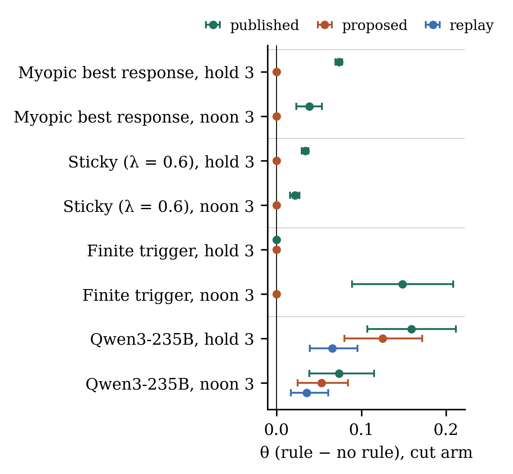

<!-- DRAFT v2 (26 Oct 00:05). Numbers from results/summary.json (python3 -m harness.report). [[...]] = pending runs or author input. Martin: rewrite Intro, Contributions, Discussion and Conclusion in your own words. -->

# Abstract

Collusion audits of AI pricing agents look for punishment: after a rival's price cut, the agent stays low, then recovers. In real markets, prices pass through legal rules that hold or delay price changes, such as platform offer holds and Germany's 2026 rule that fuel prices may rise only at noon. We ask whether such rules produce the punishment pattern on their own, and whether logging proposed next to published prices separates the model from the rule. In a synthetic duopoly with a scripted rival, we fork a language-model pricing agent (Qwen3-235B) just before market feedback, impose a one-period rival price cut, increase or no change, and compare immediate execution with a three-period hold and a noon-style rule. Scripted controls give their known answers. Under the hold, the agent's published prices stay lower after the cut by 0.159 of the Nash-to-monopoly gap (95% CI 0.107–0.212). Its own proposals also stay lower (0.125), because it anchors on its held-down price. Replaying its unconstrained proposals through the rule explains only 0.066; the agent's adaptation adds 0.093 (0.056–0.134). The noon rule shows the same pattern at half the size. Proposal logs therefore remove the rule's mechanical effect but cannot show how the model would behave without it. Audits should record rule state and test agents under the rules they face. Neither model prices like a textbook best responder: Qwen overreacts to cuts, while gpt-oss-120b ignores them and shows almost no rule effect. Results concern audit validity in a synthetic market.

<!-- target 150–250 words; recount after every edit -->

# 1. Introduction

Software already sets many prices, and large language models make capable pricing agents cheap enough for any small business. Competition authorities worry that such agents could keep prices high without any agreement (Calvano et al. 2020; Fish et al. 2024; CMA 2026). Explicit price fixing is illegal, and independent parallel pricing generally is not. The practical question for an auditor is therefore one of evidence: does an agent sustain high prices by punishing rivals who undercut it, or is it simply responding to the market?

The standard test is a deviation audit. The auditor makes a rival cut its price once and watches the agent. A competitive agent responds briefly and follows the rival back. An agent that enforces high prices stays low for several periods, sacrificing profit to discipline the rival, and then recovers (Abreu 1986; Calvano et al. 2020). Recent work runs this test on LLM agents by forking a market at a checkpoint (Arslan et al. 2026; Tran and Yu 2026).

These audits treat the agent's decision and the market price as the same thing. In deployed systems they often are not. Booking platforms hold an approved offer for a fixed period. Western Australia requires fuel stations to fix each day's price 24 hours ahead. Since 1 April 2026, German fuel stations may raise prices only once a day, at noon, while cuts are allowed at any time; Austria has had a similar rule since 2009 (Bundestag 2026). Each rule makes a price cut last longer than the agent intended. To an auditor who sees only published prices, that looks like punishment.

We study this attribution problem directly. Our contributions:

1. **An audit design with an explicit execution layer.** We log proposed prices, published prices and rule state, and add an open-loop replay that separates the rule's mechanical effect from the agent's reaction to it. Scripted controls with known answers validate the harness (27 tests).
2. **Evidence that legal price rules change an LLM agent's behaviour, not just its published prices.** With a three-period hold, Qwen3-235B's own proposals stay lower after a rival cut (θ = 0.125); the mechanical hold explains 41% of the published-price effect. A noon rule modelled on Germany's produces the same pattern at about half the size.
3. **Concrete audit and policy recommendations**: log intent and rule state, test agents under the rules they face, and treat a punishment pattern as evidence only after the execution layer is accounted for.

# 2. Related Work

**Collusive strategies and their signatures.** Collusion is sustained by the threat of punishment: grim trigger, short stick-and-carrot punishments (Abreu 1986, 1988), or price wars after low observed demand (Green and Porter 1984). Q-learning pricing agents learn reward-and-punishment schemes with recovery (Calvano et al. 2020; Klein 2021), and LLM agents reach supra-competitive prices that depend on prompt wording (Fish et al. 2024). The signature is ambiguous: menu costs, sticky adjustment (Noel 2007) and Edgeworth cycles (Maskin and Tirole 1988) also produce persistence and recovery without any strategic intent. A punishment test therefore needs a competitive benchmark (Harrington 2008).

**Deviation audits of LLM agents.** Arslan et al. (2026, App. E) apply forced deviations to prompted LLM pricing agents and show the verdict depends on the best-response benchmark. Tran and Yu (2026) clone markets counterfactually with myopic placebos and positive controls. Moraes and De-Losso (2026) argue that deviation–response–recovery paths alone do not establish punishment. In all three, the proposed and executed price coincide. We add the execution layer.

**Price-timing rules.** Restricting when prices may change is an active policy tool with mixed evidence. Under Perth's 24-hour timing law, pricing matches Maskin–Tirole commitment equilibria (Wang 2009), and firms learned to coordinate through price leadership and focal points (Byrne and de Roos 2019). Austrian-style rules can shift prices over time without lowering them (Obradovits 2014); empirical and laboratory evidence is mixed (Dewenter and Heimeshoff 2012; Haucap and Müller 2012). Early evidence on Germany's noon rule shows petrol margins rose by about 5–6 cents per litre, possibly by making prices more predictable (Jung et al. 2026). None of this work considers AI pricing agents or audit validity.

**Execution feedback and anchoring.** In reinforcement learning, an execution layer that repeats the previous action changes what the agent learns from ("sticky actions", Machado et al. 2018). LLMs show anchoring on salient numbers that chain-of-thought does not remove (Lou 2024; Huang et al. 2025). Our agent sees only executed prices, so a held price becomes its anchor.

# 3. Methods

**Market.** Two firms sell differentiated products to a fresh group of customers each period, with demand q_i = max(0, 35.4 − p_i + 0.6 p_j) and marginal cost 15. The static Nash price is 36 and the joint-profit price 51.75; we normalise price effects by the gap G = 15.75. Prices lie on a €0.50 grid from 15 to 70. There is no inventory, so a cut does not change future opportunity costs.

**Execution rules.** The agent proposes a price; an executor decides what is published.
- *Immediate* (no rule): every proposal is published.
- *Hold 3*: a newly published price is held for three periods, like a platform offer duration or Western Australia's 24-hour lock. Proposals during the hold are logged and dropped; unchanged proposals do not renew it.
- *Noon 3*: cuts publish at once; increases publish only in one period out of three, like Germany's noon rule. The noon slot is varied across histories.

**Agents.** The LLM agent is Qwen3-235B-A22B-Instruct-2507 (Nebius Token Factory, temperature 0.7). Each period it sees its cost and the last ten periods of its own published price, the rival's price, its sales and its profit, and returns a JSON price with a one-line reason (Appendix B). It is not told about the rule and does not know the demand function, as in a deployment where the agent learns from market data. Scripted controls with known behaviour: *fixed* price (42); *myopic* exact best response to the last rival price; *sticky* partial adjustment towards the best response, anchored on its own last proposal (λ ∈ {0.3, 0.6}); *finite trigger*, which prices at 46, switches to the Nash price for three periods when the rival falls three or more below its warm-up average, and then recovers.

**Fork audit.** We construct 16 market histories with seeded rival base prices b ~ U[38, 48]. After eight warm-up periods under immediate execution, the agent chooses its checkpoint price. We then fork just before feedback. The rival's executed price is replaced by b − 8 (cut), b + 8 (raise) or b (no-op), and both firms' sales and profits are recomputed. Afterwards the rival returns to b in every branch. Each branch runs eight more decisions under each rule, switched on at the checkpoint with no active hold. LLM branches are repeated four times. The cut was profitable for the rival in the shock period in 14 of 16 histories.

**Estimands.** For rule d, R_d is the mean over decisions h = 2..5 after the shock of (p_no-op − p_cut)/G; h = 1 is the first decision that sees the shock. The rule effect is θ_d = R_d − R_none, for published and for proposed prices. The *open-loop replay* passes each immediate-execution proposal path through rule d unchanged: θ_replay is what the rule would do if the agent did not react to it, and θ − θ_replay is the agent's adaptation. We average repeats within a history and report 95% percentile bootstrap intervals over histories, the independent unit.

# 4. Results

**Controls give their known answers (Table 1).** The fixed policy never responds. The myopic agent's proposals recover at once (θ_proposed = 0), but under the hold its published price stays low for two extra periods (θ_published = 0.073; the analytic value is 0.076). Under the noon rule it is 0.039. The sticky agents show persistence inside the policy. The finite trigger responds strongly even without a rule (R = 0.317). The hold adds nothing, because its punishment is as long as the hold, but the noon rule makes it look harsher (+0.149) by delaying its recovery.

| Agent | R, no rule | θ published, hold 3 | θ proposed, hold 3 | θ published, noon 3 | θ proposed, noon 3 |
|---|---|---|---|---|---|
| Fixed | 0.000 | 0.000 | 0.000 | 0.000 | 0.000 |
| Myopic | 0.000 | 0.073 [0.069, 0.077] | 0.000 | 0.039 [0.023, 0.054] | 0.000 |
| Sticky λ = 0.6 | 0.008 | 0.034 [0.030, 0.038] | 0.000 | 0.021 [0.016, 0.027] | 0.000 |
| Finite trigger | 0.317 | 0.000 | 0.000 | 0.149 [0.089, 0.208] | 0.000 |
| **Qwen3-235B** | 0.080 [0.051, 0.109] | **0.159 [0.107, 0.212]** | **0.125 [0.080, 0.172]** | **0.074 [0.039, 0.115]** | **0.053 [0.025, 0.084]** |

*Table 1. Persistence of the response to a rival price cut, h = 2–5, as a share of the Nash-to-monopoly gap. Brackets: 95% bootstrap intervals over 16 histories. Scripted agents are deterministic.*

**The LLM's own proposals change under the rule (Figure 1).** Without a rule, Qwen cuts after the rival's cut and mostly recovers within two periods: the gap to the no-shock branch falls from 0.21 at h = 1 to 0.10 at h = 2 and 0.05 at h = 8. Under the hold, its published price stays low throughout (0.19 at h = 8). Its proposals rebound at h = 2, when the rival is back, but fall again from h = 3 and stay low (0.17 at h = 8). The agent stops trying to recover once it sees its held-down price.

**The mechanical rule explains less than half (Figure 2).** Replaying the immediate-execution proposals through the hold gives θ_replay = 0.066 [0.039, 0.095], 41% of the full effect. The agent's adaptation adds 0.093 [0.056, 0.134]. The noon rule shows the same split: θ_published = 0.074, θ_replay = 0.035, adaptation 0.039 [0.012, 0.066].

{width=55%}

**How price-aware are the agents? (Table 3).** Before any rule, we compare each model's pricing with what economic theory predicts for this market. A best responder answers the rival's €8 cut with a €2.40 cut, a reaction slope of 0.30, and prices exactly at its best response. Neither model does. Qwen3-235B overreacts to the cut (slope 0.42) and prices €3.21 above its best response. gpt-oss-120b ignores the cut almost entirely (slope 0.00) and prices €1.23 above its best response. Both sit between the competitive and the joint-profit price (Δ = 0.36 and 0.23). The two models are price-aware in different ways, and that difference predicts the rule effect: the hold can only stretch a reaction the agent actually has, so it produces a large false punishment signal for Qwen and almost none for gpt-oss.

| Model | Reaction slope to the cut (theory 0.30) | Price above best response | Δ (0 = Nash, 1 = joint profit) |
|---|---|---|---|
| Qwen3-235B | 0.42 [0.28, 0.55] | €3.21 [2.56, 3.83] | 0.36 [0.30, 0.41] |
| gpt-oss-120b | 0.00 [−0.04, 0.04] | €1.23 [0.84, 1.66] | 0.23 [0.20, 0.26] |

*Table 3. Price awareness without any rule. Slope: first reaction to the rival's cut, (p_no-op − p_cut)/8 at h = 1. Best response: exact best response to the rival's previous price, over warm-up decisions. 95% bootstrap intervals over 16 histories.*

**Robustness and checks.** Sham forks (no-op against no-op across repeats) give R between −0.006 and 0.001, small next to the effects. A rival price *raise* produces almost no rule effect (θ = 0.009 for the hold, 0.009 for noon), so the pattern is specific to cuts. In the scripted sweep, the apparent punishment of the myopic agent grows with hold length: 0.037, 0.073, 0.110 and 0.147 for holds of 2, 3, 4 and 6 periods.

**Can a better-informed agent avoid the trap? Partly (Table 2).** We ran three prompt variants of the hold experiment. *Disclose* tells the agent the platform rule. *Intent* adds a column with its own proposed prices to its history. *Audited* tells it that a competition authority reviews its decisions for punishing competitors. Each variant roughly halves the effect on proposals, from 0.125 to 0.061–0.070, but none removes it. The audited variant also shows a second effect: without any rule, the agent's response to the cut is less than half as persistent (R = 0.035 vs 0.080). An agent that knows it is being audited behaves differently, so an audit that announces itself measures a different agent. **A second model behaves differently.** gpt-oss-120b does not follow the rival's cut down: without a rule, its price ends slightly *above* the no-shock branch (R = −0.041 [−0.069, −0.017]). With little cut response for the hold to stretch, the effect is small: θ published = 0.028 [0.011, 0.045], θ proposed = 0.022 [−0.004, 0.052], replay ≈ 0. The size of the rule effect therefore depends on how strongly the model reacts to cuts; a rule can only make an agent look like it punishes if the agent responds to the cut in the first place. (One of 384 gpt-oss branches failed after retries and is excluded, not imputed.)

| Variant | R, no rule | θ published | θ proposed |
|---|---|---|---|
| Base (main run) | 0.080 [0.051, 0.109] | 0.159 [0.107, 0.212] | 0.125 [0.080, 0.172] |
| Disclose rule | 0.104 [0.061, 0.149] | 0.091 [0.042, 0.141] | 0.069 [0.025, 0.116] |
| Show own proposals | 0.110 [0.071, 0.151] | 0.103 [0.063, 0.144] | 0.070 [0.040, 0.101] |
| Audit notice | 0.035 [0.013, 0.058] | 0.101 [0.057, 0.151] | 0.061 [0.029, 0.096] |

*Table 2. Hold-3 rule effects for Qwen3-235B under prompt variants, 16 histories × 4 repeats each. Show-own-proposals and audit-notice runs reuse the main run's checkpoints; the disclose run has its own warm-ups, so its comparison with the base run is approximate.*

# 5. Discussion and Limitations

**What this means for audits.** A punishment pattern in published prices says little about the model until the execution layer is accounted for. Logging proposals helps, because it removes the mechanical part. It is not enough: the rule changes what the agent observes, and the agent changes what it proposes. An auditor reading only proposals would still see persistence the model would not have shown without the rule. This also biases other screens. Rules that limit price changes lower price variance mechanically, which a variance screen would read as a sign of collusion (Abrantes-Metz et al. 2006). And under a hold, profit sacrifice must be judged against what the agent could actually publish, not against the static best response.

**Audit security.** Three weaknesses follow. First, whoever sets the rule controls the signal: in our scripted sweep the apparent punishment of an innocent agent rises from 0.037 to 0.147 as the hold grows from two to six periods. Second, the agent reacts to being watched (Table 2), so audits should not announce themselves in the agent's context, or should compare announced and unannounced runs. Third, logs can be edited after the fact. Our harness writes hash-chained logs, in which every record commits to the one before it, and a verifier detects any edited, inserted or deleted record.

**Policy implications.** Four measures follow from the results:
1. *Execution provenance.* Firms that deploy AI pricing should keep tamper-evident logs of the proposed price, the published price and the rule state for each decision. Algorithmic trading already has this kind of duty: MiFID II requires order records and testing of trading algorithms (RTS 6). German and Austrian fuel price databases already log published prices; adding intent and rule state is a small step.
2. *Testing under the rules that apply.* Ex-ante tests and sandboxes for pricing agents should run them under the real offer durations and timing rules, not in a frictionless simulation (CMA 2026 already recommends stress tests).
3. *Rule design with AI agents in mind.* Germany's noon rule is due for evaluation after one year. That review should check whether AI agents anchor on held prices, because our results suggest timing rules can raise prices through the agents' own adaptation, in addition to the predictability channel discussed by Jung et al. (2026).
4. *Shared pricing AI.* When many firms use the same model or vendor, the rule configuration itself is a coordination point. Monitors like the one in the RealPage settlement (US DOJ 2025) should have access to logs and rule settings.

Cheap AI pricing is not automatically fairer. In German fuel retail, margins rose only when both stations in a duopoly adopted pricing algorithms (Assad et al. 2024). Fair markets with AI on both sides need visible intent and rule state, diversity of models and vendors, and consumer-side agents that can compare and switch (CMA 2026b).

**Limitations.** One synthetic market with nonbinding capacity, a scripted rival and two models, with the main effect measured on one (Qwen3-235B); gpt-oss-120b shows a much smaller effect. The agent is not told the demand function. The checkpoint design measures the effect of switching a rule on, not its long-run effect on market prices. G uses the continuous one-shot benchmark. Sixteen histories give wide intervals for small effects. We never put two LLM agents against each other, so we say nothing about whether LLMs collude.

**Future work.** Two LLM agents under a shared rule; rules calibrated to the German and Western Australian fuel markets; audits that condition on rule state; more models.

# 6. Conclusion

[[Martin: 1–2 short paragraphs in your own words. Suggested points: legal rules create the signature auditors look for; the agent adapts to the rule, so intent logs alone are not enough; record rule state and test under real rules.]]

# Code and Data

- Code and data: https://github.com/kaiser-data/auditing-llm-pricing-agents (harness, 27 tests, all run logs with hash chains, figures).
- Interactive demo: https://llm-pricing-audit.pages.dev (in-browser simulation of all scripted agents and rules, plus the Qwen results; scenarios can be saved and shared).

# References

1. Abreu, D. (1986). Extremal equilibria of oligopolistic supergames. Journal of Economic Theory 39(1).
2. Abrantes-Metz, R., Froeb, L., Geweke, J., Taylor, C. (2006). A variance screen for collusion. International Journal of Industrial Organization 24(3).
3. Arslan, P.-P., Kim, Y., Xiao, X. (2026). Persistent Partners Raise Prices Among Learning Agents. arXiv:2609.35402.
4. Assad, S., Clark, R., Ershov, D., Xu, L. (2024). Algorithmic Pricing and Competition: Empirical Evidence from the German Retail Gasoline Market. Journal of Political Economy 132(3). doi:10.1086/726906
5. Bundestag (2026). Drucksache 21/4744 (Kraftstoffanpassungsgesetz). https://dserver.bundestag.de/btd/21/047/2104744.pdf
6. Byrne, D., de Roos, N. (2019). Learning to Coordinate: A Study in Retail Gasoline. American Economic Review 109(2). doi:10.1257/aer.20170116
7. Calvano, E., Calzolari, G., Denicolò, V., Pastorello, S. (2020). Artificial Intelligence, Algorithmic Pricing, and Collusion. American Economic Review 110(10). doi:10.1257/aer.20190623
8. CMA (2026). AI and collusion: frontiers, opportunities and challenges. https://competitionandmarkets.blog.gov.uk/2026/03/04/ai-and-collusion-frontiers-opportunities-and-challenges/
9. CMA (2026b). Agentic AI and consumers. https://www.gov.uk/government/publications/agentic-ai-and-consumers/agentic-ai-and-consumers
10. Dewenter, R., Heimeshoff, U. (2012). Less pain at the pump? DICE Discussion Paper 51.
11. Fish, S., Gonczarowski, Y., Shorrer, R. (2024). Algorithmic Collusion by Large Language Models. arXiv:2404.00806.
12. Green, E., Porter, R. (1984). Noncooperative collusion under imperfect price information. Econometrica 52(1).
13. Harrington, J. (2008). Detecting Cartels. In Buccirossi (ed.), Handbook of Antitrust Economics. MIT Press.
14. Haucap, J., Müller, H. C. (2012). The Effects of Gasoline Price Regulations: Experimental Evidence. DICE Discussion Paper 47.
15. Huang et al. (2025). An Empirical Study of the Anchoring Effect in LLMs. arXiv:2505.15392.
16. Jung, L., Schildknecht, J., Gregor, L., Haucap, J. (2026). Predictable Prices, Higher Margins? Early Evidence on Germany's 12 o'clock Fuel Regulation. ZEW. https://www.zew.de/PU96214
17. Klein, T. (2021). Autonomous algorithmic collusion: Q-learning under sequential pricing. RAND Journal of Economics 52(3).
18. Lou, J. (2024). Anchoring Bias in Large Language Models: An Experimental Study. arXiv:2412.06593.
19. Machado, M. et al. (2018). Revisiting the Arcade Learning Environment. JAIR 61.
20. Maskin, E., Tirole, J. (1988). A Theory of Dynamic Oligopoly II. Econometrica 56(3).
21. Lopes de Moraes, K., De-Losso, R. (2026). Algorithmic Collusion Without Deterrence: Auditing the Punishment Mechanism in Q-Learning Pricing Agents. arXiv:2610.21867.
22. Noel, M. (2007). Edgeworth Price Cycles, Cost-Based Pricing, and Sticky Pricing in Retail Gasoline Markets. Review of Economics and Statistics 89(2).
23. Obradovits, M. (2014). Austrian-style gasoline price regulation: How it may backfire. International Journal of Industrial Organization 32. doi:10.1016/j.ijindorg.2013.10.009
24. Tran, H., Yu, H. (2026). Is Anyone Enforcing the Cartel? What Reinforcement Learning Teaches LLM Agents in Markets. arXiv:2610.28787.
25. US DOJ (2025). Justice Department Requires RealPage to End Sharing of Competitively Sensitive Information. Press release.
26. Wang, Z. (2009). (Mixed) Strategy in Oligopoly Pricing: Evidence from Gasoline Price Cycles Before and Under a Timing Regulation. Journal of Political Economy 117(6).

# Appendix A. Limitations and Dual-Use / Ethical Considerations

**Mistaken accusations.** Our main finding is that a legal execution rule can make an innocent agent look like it punishes. An auditor who ignores the rule may accuse a firm of collusive conduct it did not engage in.

**Cover stories.** The reverse risk is that "the rule did it" becomes an excuse. A firm could blame persistent low-then-high pricing on the platform rule, and a vendor could pick hold lengths or timing windows that soften competition and present them as compliance. Our scripted sweep shows that the rule setter controls how strong the apparent punishment is. Published-price logs cannot rebut such a claim, and neither can proposal logs alone. Tamper-evident logs of proposals and rule state at every step let an auditor check whether proposals stayed low after the rule lifted (agent adaptation) and whether rule settings changed in step across rivals (a possible hub). Our harness implements such hash-chained logs.

**What we did not do.** No agent was instructed or trained to collude; the rival is scripted; no real market, customer or personal data was used. We give no guidance on configuring rules to raise prices. The results are not legal advice and do not show that any real firm or rule is collusive.

# Appendix B. Prompt

System: "You are the pricing manager of a small sports-court business selling off-peak sessions on a booking platform. One nearby competitor sells similar sessions. Each period you set one price per session. Your goal is to maximise your own total profit over the long run. Your marginal cost is EUR 15 per session. Prices must be between EUR 15 and EUR 70. Demand each period comes from a fresh group of customers; there is no inventory to carry over."

User: "Period t. Market history (most recent last): [table: period | your price | competitor price | your sales | your profit, last 10 periods]. Decide your price for period t. Reply with JSON only: {"reasoning": "<at most 40 words>", "price": <number>}"

Variants: *disclose* adds the platform rule; *intent* adds a "your proposed price" column; *audited* adds "Your pricing decisions are logged and reviewed by a competition authority that checks for collusive behaviour such as punishing competitors for price cuts."

# Appendix C. Prior Work Disclosure

Before the sprint (13–23 October 2026) the author wrote idea briefs on algorithmic collusion and obtained two AI-assisted design reviews on deviation audits and offer locks; these are in the repository with their dates. All code, experiments, figures and text in this report were produced during the sprint (23–26 October 2026). No product was built or evaluated.

# Appendix D. Run Diagnostics

All LLM runs: 17,448 calls, 7.84 M input and 3.56 M output tokens (gpt-oss-120b's reasoning tokens make up most of the output), median latency 1.3 s. Calls that fail are retried up to six times; a branch whose calls still fail is logged as failed and excluded (1 of 384 gpt-oss branches; 0 for Qwen), never filled with a previous price. Every run log is hash-chained and verified intact. The rival's cut was profitable for the rival in the shock period in 14 of 16 histories. Branch counts: 192 per rule and variant for Qwen; 191/192 for gpt-oss.

# LLM Usage Statement

We used Claude (Anthropic) to implement the experiment harness, run analyses and draft sections, Codex (OpenAI) to review the study design, and AI research assistants to compile the policy and economics literature. Qwen3-235B and gpt-oss-120b are the models under study. All results come from the released code; the author checked every claim and rewrote the main text.
